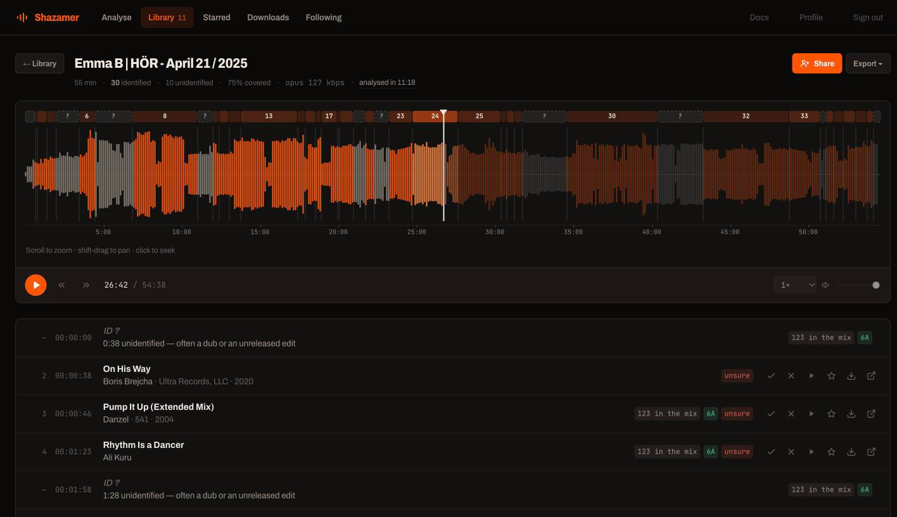

<h1 align="center">Shazamer 🎛️</h1>

<p align="center">
  <b>Identify every track in a DJ set, see it on the waveform, and go find the records.</b>
</p>

<p align="center">
  <a href="https://shazamer.pierregallet.com"><b>Try it</b></a> ·
  <a href="https://shazamer.pierregallet.com/docs/">Docs</a> ·
  <a href="#self-host-with-docker">Self-host</a> ·
  <a href="https://github.com/PierreGallet/shazamer/issues">Report a bug</a>
</p>

<p align="center">
  <a href="https://shazamer.pierregallet.com"></a>
  <a href="LICENSE"></a>
  <a href="https://github.com/PierreGallet/shazamer/actions"></a>
</p>

<p align="center">
  
</p>

Paste a mix from YouTube, SoundCloud or Instagram, or upload the file.
Shazamer gives you back a timestamped tracklist with BPM and key, drawn on a
waveform you can scrub through, and every track links to where you can buy it.

## Why Shazamer

- 🎚️ **Made for mixes.** It probes the whole set on a grid and merges what
  matches, so beatmatched 32-bar blends do not break it. Sets of any length,
  at a flat ~24 MB of memory.
- 🕳️ **Keeps the gaps.** A stretch nobody can name stays in the tracklist
  with its timestamp. Dubs, edits and unsigned promos are the point of
  digging.
- 🎹 **Usable at the decks.** BPM and Camelot key on every track, and an
  export to Rekordbox XML (plus M3U, CSV, text and JSON).
- 🔁 **Remembers.** Every set lands in your library. A record turning up in
  several sets is surfaced, which is the strongest digging signal there is.
- 🛒 **Points at the record.** Bandcamp, Beatport and Discogs links first.
- 🤝 **Shares.** Send a set to someone and they get their own copy, audio
  included.

## Hosted or self-hosted

|  | **[shazamer.pierregallet.com](https://shazamer.pierregallet.com)** | **Self-hosted** |
| --- | --- | --- |
| Setup | None: sign in with your email (one-time code, no password) | Docker Compose, or Python 3.12 + ffmpeg + Node |
| Long sets | Analysed on a queue: close the tab, come back to a finished tracklist | Same, with Redis (included in the Compose file) |
| Sign-in | Ready | Needs an SMTP server to send the codes |
| Cost | Free | Free, MIT-licensed |

## Self-host with Docker

```bash
git clone https://github.com/PierreGallet/shazamer.git && cd shazamer
cp .env.example .env        # set SMTP_HOST, SMTP_USER, SMTP_PASSWORD, MAIL_FROM
docker compose up -d        # API, worker and Redis on http://localhost:8000
```

Soulseek acquisition is optional and stays off unless `SLSKD_URL` points at
your own [slskd](https://github.com/slskd/slskd) instance, with your own
account and shares.

## Run from source

```bash
brew install ffmpeg node    # or: sudo apt-get install ffmpeg nodejs
make install                # Python 3.12 venv + frontend dependencies
make web                    # builds the UI and serves everything on :8000
```

There is also a command line, `make analyze FILE="~/Music/dj_set.mp3"`.
Its options, the configuration, the tests and importing pre-1.0 tracklists
are in [Running it](https://shazamer.pierregallet.com/docs/running/).

## How it works

```
URL ──▶ yt-dlp ──▶ ffmpeg (30 s blocks) ──▶ spectral centroid + RMS
                                                     │
                            probe grid ──▶ ffmpeg -ss (12 s) ──▶ Shazam ×8
                                                     │
                                    merge ──▶ segments ──▶ BPM + key ──▶ library
```

Audio is streamed, never loaded whole. Identification runs in parallel, and a
boundary between two tracks comes out of the results instead of being guessed
first. The design, and the measurements behind it, are in the
[docs](https://shazamer.pierregallet.com/docs/).

## Contributing

Issues and pull requests are welcome. `make test` runs the suite against
synthetic audio, with no network. Changes go through a pull request with a
green CI.

## License

MIT — see [LICENSE](LICENSE).
